---

### `~/stack`

---

<!--
### `~/work`

| 项目 | 做了什么 | 栈 |
| :-- | :-- | :-- |
| **[VoltNest](https://github.com/Stardust011/VoltNest)** | Windows / Linux 上的 HID · BLE 设备电量监控。单进程 Rust，托盘常驻，聚合 2.4G 接收器与 BLE Battery Service 的电量、在线与充电状态；Provider → 状态机 → 前端单向数据流 | `Rust` `Tauri 2` `Vue 3` `Slint` |
| **[Bitwarden-Password-Cleaner](https://github.com/Stardust011/Bitwarden-Password-Cleaner)** | 清理 Bitwarden 导出文件：去重、校验 URL 可达性、重新导出 JSON | `Python` |
| **[ffmpeg-gyan-updater](https://github.com/Stardust011/ffmpeg-gyan-updater)** | 基于 gyan.dev git builds，自动更新 Windows 上的 FFmpeg | `PowerShell` |
| **[Anti-spam-repository](https://github.com/Stardust011/Anti-spam-repository)** | 用广告过滤插件自定义规则，屏蔽中文垃圾代码仓库 | `Adblock` |

---
-->

### `~/stats`

  
  

---

<!--
### `~/links`

-->

`// ship. iterate. repeat.`
